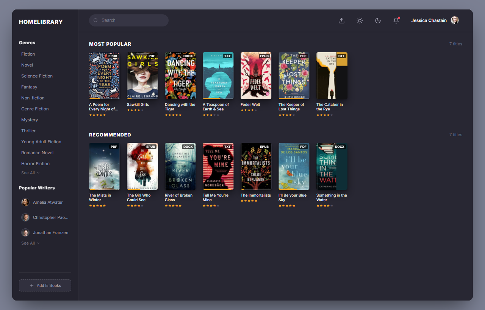
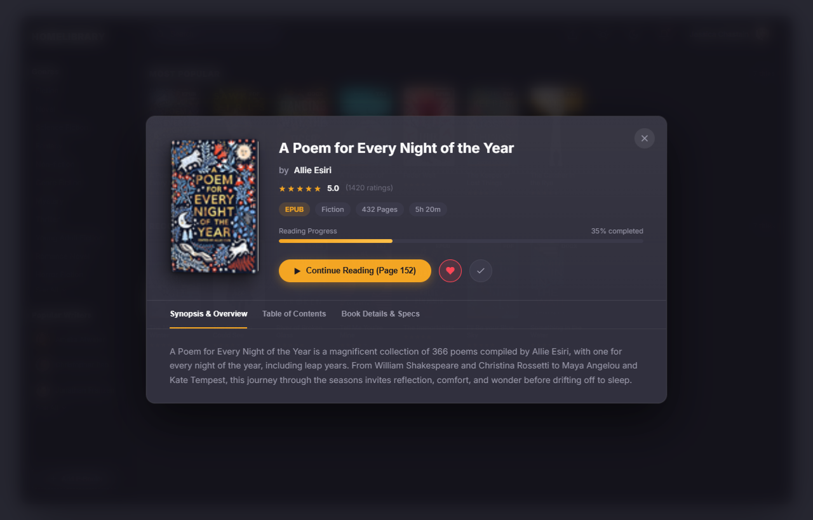
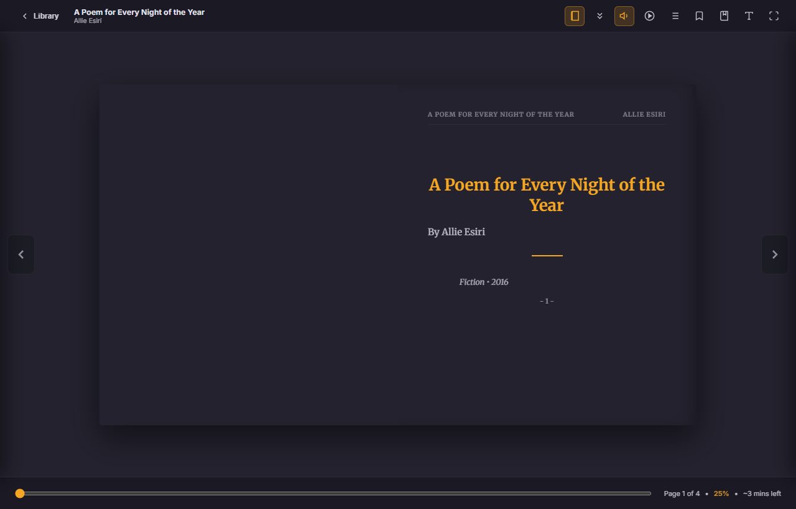

# HomeLibrary — EBook Reader Desktop Application
### High-Fidelity Replica of Dribbble Concept UI (Dark UI)

A modern, distraction-free desktop E-Book reader crafted to replicate the **Dribbble "Book App Concept for Web - Dark UI"** design by Buwaneka Ranatunge.



---

## 🌟 Key Features

### 1. Exact Replica of the Dribbble UI
* **Deep Dark UI Aesthetic**: Rich charcoal palette (`#282733`, `#24232e`, `#363544`) with subtle borders and shadows.
* **Exact Sidebar Layout**:
  * Brand Header: **`HOMELIBRARY`**
  * **Genres** Category Filter: *Fiction, Novel, Science Fiction, Fantasy, Non-fiction, Genre Fiction, Mystery, Thriller, Young Adult Fiction, Romance Novel, Horror Fiction*.
  * **Popular Writers** with avatars: *Amelia Atwater, Christopher Paolini, Jonathan Franzen*.
  * Responsive filters for instant shelf filtering.
* **Top Header**:
  * Real-time search pill input (`🔍 Search`) filtering books and authors.
  * Night Light warmth slider button.
  * Theme switcher.
  * Notification bell with active alert badge.
  * User profile: **`Jessica Chastain`** with avatar.
* **Two Exact Preloaded Bookshelves**:
  * **MOST POPULAR**: 7 books with authentic covers, star ratings, and progress tracking:
    1. *A Poem for Every Night of the Year* (Allie Esiri) — 5 ★
    2. *Sawkill Girls* (Claire Legrand) — 4 ★
    3. *Dancing with the Tiger* (Lili Wright) — 5 ★
    4. *A Teaspoon of Earth & Sea* (Dina Nayeri) — 3 ★
    5. *Feder Welt* (Laura Newman) — 4 ★
    6. *The Keeper of Lost Things* (Ruth Hogan) — 4 ★
    7. *The Catcher in the Rye* (J.D. Salinger) — 4 ★
  * **RECOMMENDED**: 7 books with authentic covers and star ratings:
    1. *The Mists in Winter* (Judith Merkle Riley) — 5 ★
    2. *The Girl Who Could See* (Kara Swanson) — 4 ★
    3. *River of Broken Glass* (Christine Finlayson) — 5 ★
    4. *Tell Me You're Mine* (Elisabeth Norebäck) — 4 ★
    5. *The Immortalists* (Chloe Benjamin) — 5 ★
    6. *I'll Be your Blue Sky* (Marisa de los Santos) — 5 ★
    7. *Something in the Water* (Catherine Steadman) — 4 ★

---

### 2. Beautiful Book Details Interface
Clicking any book opens an aesthetic modal featuring:
* **3D Perspective Book Cover** with realistic spine crease, paper edge textures, and soft drop shadow.
* Metadata badges: File Format (`EPUB`, `PDF`, `DOCX`, `TXT`), Genre, Page Count, and Estimated Reading Time.
* Interactive 5-star rating and community ratings count.
* Reading Progress tracker bar.
* Primary **Read Book** / **Continue Reading** action.
* Secondary actions: Favorite (heart), Mark as Finished (check), and direct chapter selection.
* Navigation tabs: **Synopsis & Overview**, **Table of Contents**, and **Book Details & Specs**.



---

### 3. Clean, Immersive Reader Interface
Clicking "Read" opens a reader interface equipped with:
* **Realistic 3D Page Turn Effect**:
  * Uses physics-based paper curling, shadows, and lighting gradients.
  * Can drag page corners with mouse, click navigation arrows, or use keyboard arrow keys / spacebar.
  * Realistic paper rustle sound effect synthesized using the HTML5 Web Audio API (toggleable).
* **Reading Progress Scrubber Bar**:
  * Full-width scrubber slider with live page jumping.
  * Displays current page, total pages, percentage completed, and estimated time remaining.
* **Themes (App-Wide & Reader-Specific)**:
  * 🌙 **Dark Mode** (`#282733` Dribbble aesthetic)
  * ☀️ **Light Mode** (Clean Apple Books paper white)
  * 📜 **Sepia Mode** (Warm parchment paper and vintage ink)
  * 🕯️ **Night Light Amber Mode** (Ultra-low blue light for reading in pitch darkness)
  * 🖤 **AMOLED Mode** (Pure #000000 black for OLED screens)
* **Adjustable Night Light Warmth Filter**: Slider from 0% to 100% warmth to eliminate eye strain.
* **Typography Controls**:
  * Font selector: *Merriweather (Serif)*, *Inter (Sans)*, *Georgia*, *Monospace*.
  * Font size slider (14px to 28px).
* **Alternative View Modes**:
  * 📖 Realistic 3D Paper Flip (two-page book spread)
  * 📜 Continuous Smooth Scroll
* **Text-to-Speech (TTS) Read Aloud**:
  * Listen to any page aloud using the native Speech Synthesis API.
* **Table of Contents & Bookmarks Drawer**:
  * Slide-over Table of Contents drawer for jumping to any chapter.
  * Bookmarking ribbon to save pages and resume later.
* **Auto-Save Reading Progress**: Automatically resumes at your exact page across sessions.



---

### 4. Supported Book Formats & Library Management
* **PDF**: Native rendering via Mozilla PDF.js with crisp Retina resolution. Automatically generates thumbnail cover from Page 1 and extracts table of contents.
* **EPUB**: Parsed via JSZip and XHTML renderer. Extracts embedded cover artwork, metadata, and chapter spine.
* **DOCX**: Native Word document parsing via Mammoth.js. Automatically formats headings, paragraphs, and tables.
* **TXT & Markdown**: Auto-paginating literary parser with chapter heading detection and typographic formatting.
* **Drag-and-Drop Import**: Drag any `.pdf`, `.epub`, `.docx`, `.txt`, or `.md` file onto the window to automatically add it to your shelf.
* **Persistent Library**: All imported books, covers, reading progress, and bookmarks are stored permanently in browser `IndexedDB` and `localStorage`.

---

### 5. Internet Archive Downloader & OCR Extractor
* **Archive Downloader Tab**: Input any Internet Archive book item ID or URL to inspect metadata, page counts, and formats.
* **Multi-Format Extraction**: Downloads and extracts scanned book archives into:
  * High-resolution Page Scans / PDF
  * Clean Raw OCR Text (`.txt`)
  * Structured RAG/AI Knowledge JSON (`.json`)
  * Formatted Microsoft Word Document (`.docx`) with Indic font styling
* **Offline Library Database**: Automatically organizes downloaded files in the background (`Internet Archive Books/`) and surfaces PDFs on the main bookshelf.
* **OCR & Clean Text Tab**: Browse all extracted text files, read them directly inside the reader, or download DOCX/TXT/JSON with one click.

---

### 6. Bookshelf & Category Editing
* **Custom Category / Genre Editor**: Click on any book's genre chip or the edit button in the details modal to edit genres, assign sub-genres, or create custom genres.
* **Live Dynamic Sidebar Sync**: Custom genres are automatically added to the global genres list and appear dynamically in the sidebar navigation.
* **Shelf Reassignment**: Reorganize books between *Most Popular*, *Recommended for You*, and *My Archive & Downloads* shelves.

---

### 7. Multilingual Reading (Sanskrit, Odia, Hindi, English)
* **Indic Script Typography**: Integrated high-quality Indic fonts (`Noto Sans Devanagari`, `Noto Serif Devanagari`, `Noto Sans Oriya`, `Noto Serif Oriya`, `Nirmala UI`) with optimized line-height and ligature support.
* **Preloaded Classical Works**:
  * *Śrīmad Bhagavad Gītā (श्रीमद्भगवद्गीता)* — Sanskrit verses with English commentary.
  * *Chha Mana Atha Guntha (ଛମାଣ ଆଠଗୁଣ୍ଠ)* by Fakir Mohan Senapati — Classical Odia masterpiece.
  * *Godan (गोदान)* by Munshi Premchand — Epic Hindi realist novel.
* **PDF Dual-Page Book Spread (2P)**: Reads digital and scanned PDFs with realistic two-page spread, central book spine crease, Fit-to-Page, Fit-to-Width, and Zoom (70% - 200%).
* **Clean Reflow Mode**: Switch between high-resolution scan canvas and reflowable text with Indic fonts for scanned books with OCR text layers.
* **Multilingual TTS Read-Aloud**: Automatically selects suitable speech synthesis voices for Hindi, Odia, Sanskrit, and English.

---

## 🚀 How to Run the Desktop Application

### Option 1: One-Click Desktop Batch Launcher
Double-click:
```bat
launch.bat
```
This automatically starts the zero-dependency local background server and launches Microsoft Edge or Chrome in a standalone, dedicated **Desktop Application Mode** (borderless window, hardware-accelerated, zero browser address bars).

### Option 2: Silent Launcher (No Command Prompt Window)
Double-click:
```vbs
launch.vbs
```

### Option 3: Browser
Open `http://localhost:4891` in any modern web browser.

